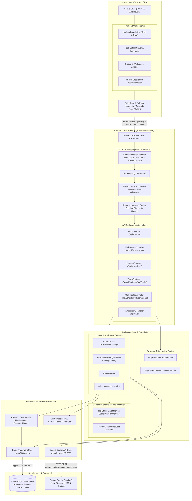
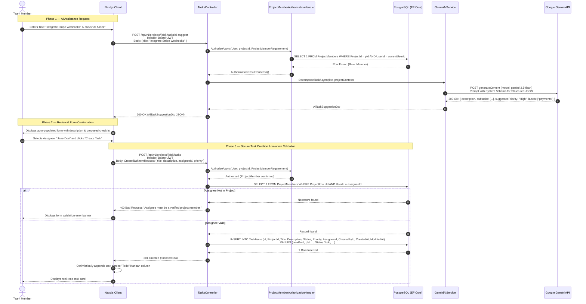
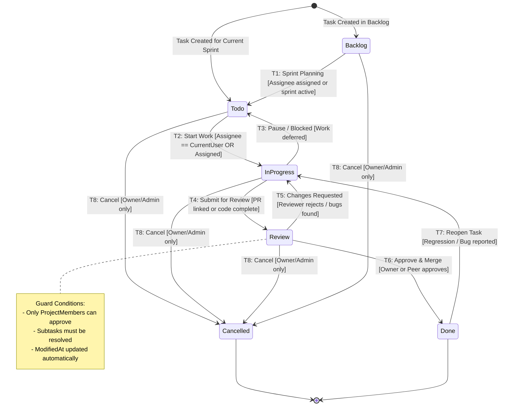
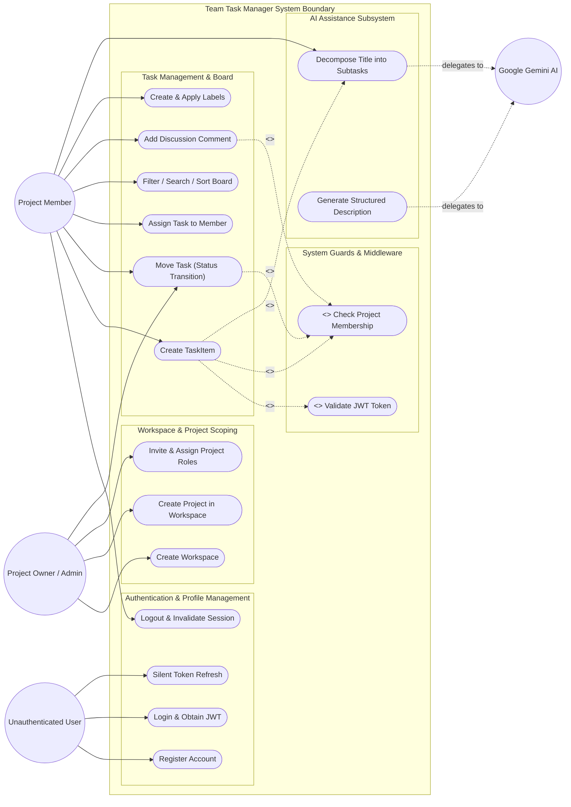
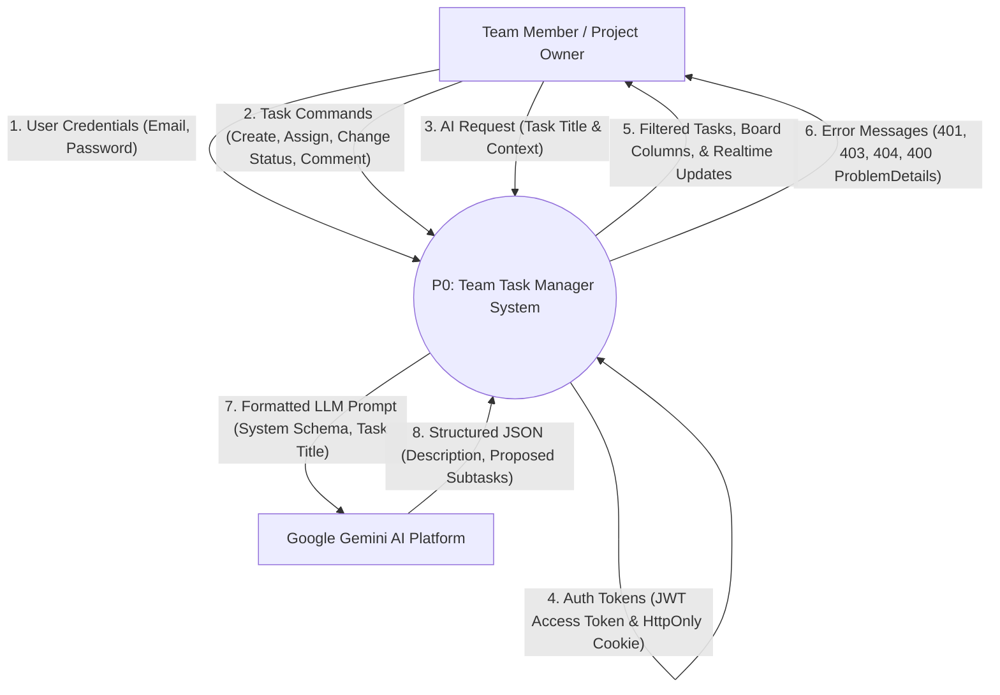
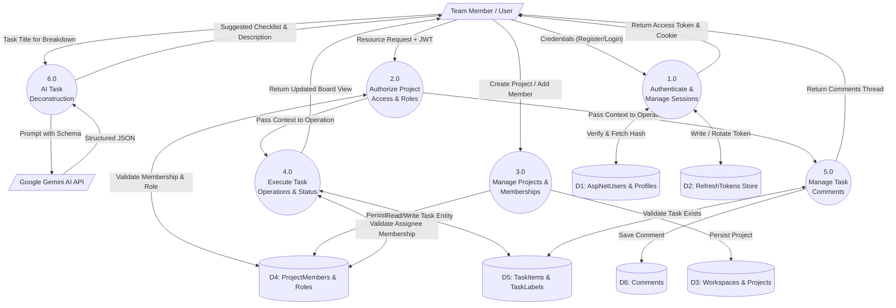
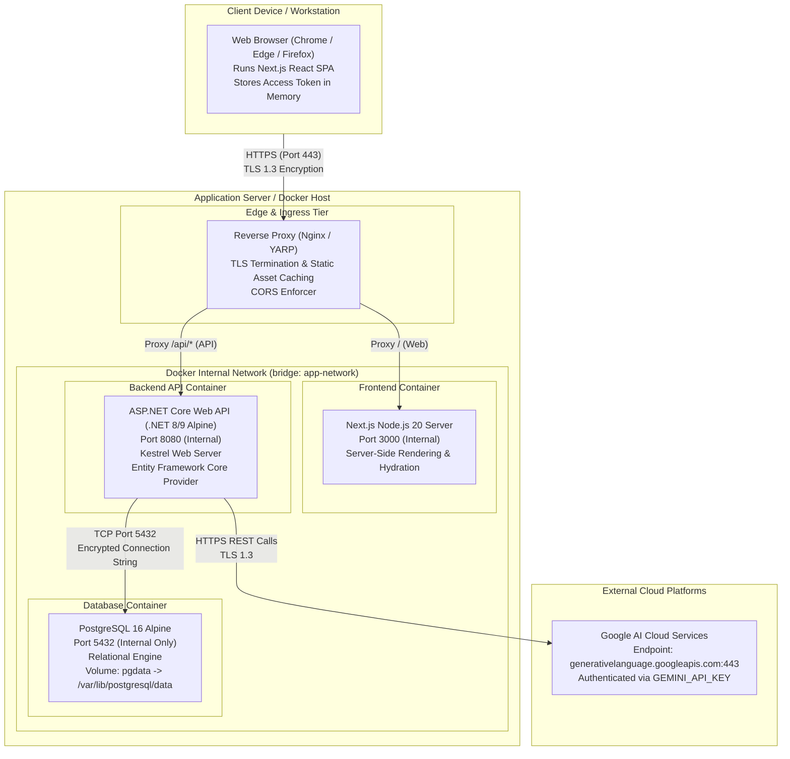

# Team Task Manager (Mini Jira) — Software Engineering Architecture & Diagrams

> **Project Reference:** `PROJECT_02_TEAM_TASK_MANAGER_MASTER_PLAN.md`  
> **Target Framework:** ASP.NET Core (.NET 8/9), Entity Framework Core, PostgreSQL, Next.js (TypeScript), Google Gemini API  
> **Document Status:** Comprehensive Production-Grade Architectural Specification  

---

## Table of Contents

1. [Domain Class Diagram](#1-domain-class-diagram)
2. [Component & Layered Architecture Diagram](#2-component--layered-architecture-diagram)
3. [Entity-Relationship (ER) Diagram](#3-entity-relationship-er-diagram)
4. [Sequence Diagrams](#4-sequence-diagrams)
   - [4.1 End-to-End Secure Task Creation with AI Decomposition](#41-end-to-end-secure-task-creation-with-ai-decomposition)
   - [4.2 JWT Authentication & Silent Token Refresh Lifecycle](#42-jwt-authentication--silent-token-refresh-lifecycle)
5. [State Machine Diagram (Task Lifecycle)](#5-state-machine-diagram-task-lifecycle)
6. [Use Case Diagram](#6-use-case-diagram)
7. [Request Processing & Resource Authorization Flowchart](#7-request-processing--resource-authorization-flowchart)
8. [Data Flow Diagrams (DFD)](#8-data-flow-diagrams-dfd)
   - [8.1 Level 0 — Context Diagram](#81-level-0--context-diagram)
   - [8.2 Level 1 — System Decomposition DFD](#82-level-1--system-decomposition-dfd)
9. [Deployment Diagram](#9-deployment-diagram)

---

## 1. Domain Class Diagram

This diagram models the object-oriented structure of the backend application, showing domain models, identity entities, enums, data contexts, and service contracts with their exact typed properties, invariants, and navigation associations.

```mermaid
classDiagram
    direction TB

    class IdentityUserGuid {
        <<ASP.NET Core Identity>>
        +Guid Id
        +string UserName
        +string Email
        +string PasswordHash
        +string SecurityStamp
        +string ConcurrencyStamp
    }

    class ApplicationUser {
        +string DisplayName
        +DateTime CreatedAt
        +DateTime ModifiedAt
        +ICollection~ProjectMember~ ProjectMemberships
        +ICollection~TaskItem~ CreatedTasks
        +ICollection~TaskItem~ AssignedTasks
        +ICollection~Comment~ Comments
        +ICollection~RefreshToken~ RefreshTokens
    }

    class Workspace {
        +Guid Id
        +string Name
        +string Description
        +Guid CreatedById
        +DateTime CreatedAt
        +ICollection~Project~ Projects
    }

    class Project {
        +Guid Id
        +Guid WorkspaceId
        +string Name
        +string Description
        +Guid CreatedById
        +DateTime CreatedAt
        +Workspace Workspace
        +ICollection~ProjectMember~ Members
        +ICollection~TaskItem~ Tasks
        +ICollection~Label~ Labels
    }

    class ProjectMember {
        +Guid Id
        +Guid ProjectId
        +Guid UserId
        +ProjectRole Role
        +DateTime JoinedAt
        +Project Project
        +ApplicationUser User
    }

    class TaskItem {
        +Guid Id
        +Guid ProjectId
        +string Title
        +string Description
        +TaskItemStatus Status
        +TaskPriority Priority
        +Guid? AssigneeId
        +Guid CreatedById
        +DateTime? DueDate
        +DateTime CreatedAt
        +DateTime ModifiedAt
        +Project Project
        +ApplicationUser Assignee
        +ApplicationUser CreatedBy
        +ICollection~Comment~ Comments
        +ICollection~Label~ Labels
        +bool CanTransitionTo(TaskItemStatus newStatus)
        +void AssignTo(Guid memberUserId)
    }

    class Comment {
        +Guid Id
        +Guid TaskItemId
        +Guid AuthorId
        +string Body
        +DateTime CreatedAt
        +DateTime ModifiedAt
        +TaskItem TaskItem
        +ApplicationUser Author
    }

    class Label {
        +Guid Id
        +Guid ProjectId
        +string Name
        +string ColorHex
        +Project Project
        +ICollection~TaskItem~ Tasks
    }

    class RefreshToken {
        +Guid Id
        +Guid UserId
        +string Token
        +DateTime ExpiresAt
        +bool IsRevoked
        +DateTime CreatedAt
        +string ReplacedByToken
        +bool IsActive
    }

    class ProjectRole {
        <<enumeration>>
        Owner
        Admin
        Member
        Viewer
    }

    class TaskItemStatus {
        <<enumeration>>
        Todo
        InProgress
        Review
        Done
    }

    class TaskPriority {
        <<enumeration>>
        Low
        Medium
        High
        Critical
    }

    class AppDbContext {
        +DbSet~Workspace~ Workspaces
        +DbSet~Project~ Projects
        +DbSet~ProjectMember~ ProjectMembers
        +DbSet~TaskItem~ TaskItems
        +DbSet~Comment~ Comments
        +DbSet~Label~ Labels
        +DbSet~RefreshToken~ RefreshTokens
        #OnModelCreating(ModelBuilder builder)
        +SaveChangesAsync(CancellationToken ct) Task~int~
    }

    class ITaskService {
        <<interface>>
        +GetProjectTasksAsync(Guid projectId, TaskFilter filter) Task~PagedList~TaskDto~~
        +GetTaskByIdAsync(Guid taskId) Task~TaskDetailDto~
        +CreateTaskAsync(Guid projectId, CreateTaskCommand cmd) Task~TaskDto~
        +UpdateStatusAsync(Guid taskId, TaskItemStatus newStatus) Task~TaskDto~
        +AssignTaskAsync(Guid taskId, Guid assigneeId) Task~TaskDto~
    }

    class IAuthorizationService {
        <<interface>>
        +AuthorizeAsync(ClaimsPrincipal user, object resource, IAuthorizationRequirement requirement) Task~AuthorizationResult~
    }

    class IAiTaskAssistantService {
        <<interface>>
        +DecomposeTaskAsync(string taskTitle, string context) Task~AiTaskSuggestionDto~
    }

    %% Inheritance
    IdentityUserGuid <|-- ApplicationUser : inherits

    %% Associations
    ApplicationUser "1" <-- "0..*" ProjectMember : UserId
    Project "1" <-- "0..*" ProjectMember : ProjectId
    Workspace "1" <-- "0..*" Project : WorkspaceId
    Project "1" <-- "0..*" TaskItem : ProjectId
    Project "1" <-- "0..*" Label : ProjectId
    TaskItem "1" <-- "0..*" Comment : TaskItemId
    ApplicationUser "1" <-- "0..*" Comment : AuthorId
    ApplicationUser "1" <-- "0..*" TaskItem : CreatedById
    ApplicationUser "0..1" <-- "0..*" TaskItem : AssigneeId
    ApplicationUser "1" <-- "0..*" RefreshToken : UserId

    %% Many to Many
    TaskItem "0..*" <--> "0..*" Label : TaskLabel (M:N)

    %% Enums
    ProjectMember ..> ProjectRole : uses
    TaskItem ..> TaskItemStatus : uses
    TaskItem ..> TaskPriority : uses

    %% DB & Service usage
    AppDbContext ..> ApplicationUser
    AppDbContext ..> Project
    AppDbContext ..> TaskItem
    ITaskService ..> TaskItem
    ITaskService ..> IAuthorizationService : validates via
    ITaskService ..> IAiTaskAssistantService : delegates to
```

---

## 2. Component & Layered Architecture Diagram

The system adopts a **Clean/Layered Architecture** with strict vertical boundary enforcement:
- The **Presentation / Web API** exposes REST endpoints and handles HTTP conventions.
- The **Cross-Cutting Pipeline** intercepts requests for Authentication, Logging, Exception Handling, and Resource-Based Authorization.
- The **Application Core** orchestrates business use cases, validations, and domain rules.
- The **Infrastructure Layer** implements persistence via EF Core & PostgreSQL, JWT handling, and external AI integration.
- The **Frontend Layer** renders the Next.js Kanban board and interacts with the API via strongly typed DTOs.



---

## 3. Entity-Relationship (ER) Diagram

The following ER diagram maps the PostgreSQL relational schema, documenting primary keys (PK), foreign keys (FK), unique constraints, index definitions, and referential integrity rules (CASCADE vs RESTRICT) matching `AppDbContext.cs`.

```mermaid
erDiagram
    AspNetUsers ||--o{ RefreshTokens : "has"
    AspNetUsers ||--o{ Workspaces : "creates"
    AspNetUsers ||--o{ Projects : "creates"
    AspNetUsers ||--o{ ProjectMembers : "participates in"
    AspNetUsers ||--o{ TaskItems : "creates (CreatedBy)"
    AspNetUsers ||--o{ TaskItems : "assigned to (Assignee)"
    AspNetUsers ||--o{ Comments : "authors"

    Workspaces ||--o{ Projects : "contains (CASCADE)"

    Projects ||--o{ ProjectMembers : "has members (CASCADE)"
    Projects ||--o{ TaskItems : "owns tasks (CASCADE)"
    Projects ||--o{ Labels : "defines (CASCADE)"

    TaskItems ||--o{ Comments : "contains (CASCADE)"
    TaskItems ||--o{ TaskItemLabel : "tagged with (CASCADE)"
    Labels ||--o{ TaskItemLabel : "applies to (CASCADE)"

    AspNetUsers {
        uuid Id PK
        varchar_256 UserName "NOT NULL"
        varchar_256 NormalizedUserName "INDEX"
        varchar_256 Email "NOT NULL"
        varchar_256 NormalizedEmail "INDEX"
        text PasswordHash "NOT NULL"
        text SecurityStamp
        varchar_150 DisplayName "NULL"
        timestamptz CreatedAt "NOT NULL"
        timestamptz ModifiedAt "NOT NULL"
    }

    RefreshTokens {
        uuid Id PK
        uuid UserId FK "NOT NULL, RESTRICT"
        text Token "NOT NULL, UNIQUE"
        timestamptz ExpiresAt "NOT NULL"
        boolean IsRevoked "NOT NULL"
        timestamptz CreatedAt "NOT NULL"
        text ReplacedByToken "NULL"
    }

    Workspaces {
        uuid Id PK
        varchar_150 Name "NOT NULL"
        text Description "NULL"
        uuid CreatedById FK "NOT NULL"
        timestamptz CreatedAt "NOT NULL"
    }

    Projects {
        uuid Id PK
        uuid WorkspaceId FK "NOT NULL, CASCADE"
        varchar_150 Name "NOT NULL"
        varchar_2000 Description "NULL"
        uuid CreatedById FK "NOT NULL"
        timestamptz CreatedAt "NOT NULL"
    }

    ProjectMembers {
        uuid Id PK
        uuid ProjectId FK "NOT NULL, CASCADE"
        uuid UserId FK "NOT NULL, RESTRICT"
        integer Role "NOT NULL (0:Owner, 1:Admin, 2:Member, 3:Viewer)"
        timestamptz JoinedAt "NOT NULL"
    }

    TaskItems {
        uuid Id PK
        uuid ProjectId FK "NOT NULL, CASCADE, INDEX"
        varchar_200 Title "NOT NULL"
        varchar_4000 Description "NULL"
        integer Status "NOT NULL, INDEX (0:Todo, 1:InProgress, 2:Review, 3:Done)"
        integer Priority "NOT NULL (0:Low, 1:Medium, 2:High, 3:Critical)"
        uuid AssigneeId FK "NULL, RESTRICT, INDEX"
        uuid CreatedById FK "NOT NULL, RESTRICT"
        timestamptz DueDate "NULL"
        timestamptz CreatedAt "NOT NULL"
        timestamptz ModifiedAt "NOT NULL"
    }

    Comments {
        uuid Id PK
        uuid TaskItemId FK "NOT NULL, CASCADE, INDEX"
        uuid AuthorId FK "NOT NULL, RESTRICT"
        varchar_4000 Body "NOT NULL"
        timestamptz CreatedAt "NOT NULL"
        timestamptz ModifiedAt "NOT NULL"
    }

    Labels {
        uuid Id PK
        uuid ProjectId FK "NOT NULL, CASCADE"
        varchar_50 Name "NOT NULL"
        varchar_7 ColorHex "NOT NULL, DEFAULT #6B7280"
    }

    TaskItemLabel {
        uuid TaskItemId PK_FK "CASCADE"
        uuid LabelId PK_FK "CASCADE"
    }
```

### Relational Schema Rules & Constraints Matrix
| Table | Unique Constraints | Indexed Columns | On Delete Cascade | On Delete Restrict |
|---|---|---|---|---|
| `ProjectMembers` | `(ProjectId, UserId)` | `ProjectId`, `UserId` | Project deletion | User deletion |
| `TaskItems` | - | `ProjectId`, `AssigneeId`, `Status` | Project deletion | Assignee deletion, Creator deletion |
| `Comments` | - | `TaskItemId`, `AuthorId` | TaskItem deletion | Author deletion |
| `Labels` | `(ProjectId, Name)` | `ProjectId` | Project deletion | - |
| `TaskItemLabel` | `(TaskItemId, LabelId)` | Composite PK | TaskItem, Label | - |

---

## 4. Sequence Diagrams

### 4.1 End-to-End Secure Task Creation with AI Decomposition

This sequence captures:
1. User initiating AI decomposition with a brief task title in the Next.js UI.
2. Resource authorization check preventing unauthorized external access.
3. Outbound structured LLM call to Google Gemini.
4. Final task persistence with assignee validation and database transaction.



---

### 4.2 JWT Authentication & Silent Token Refresh Lifecycle

This sequence demonstrates the security boundary where the short-lived access token expires and is rotated silently using a protected, HTTP-only refresh token without forcing user re-login.

```mermaid
sequenceDiagram
    autonumber
    actor User as User
    participant Browser as Browser Local State
    participant Interceptor as Axios / Fetch Interceptor
    participant API as ASP.NET Core API
    participant JWT as JwtService
    participant DB as PostgreSQL (AppDbContext)

    User->>Browser: Opens Task Board
    Browser->>Interceptor: Request GET /api/v1/projects/{pId}/tasks
    Interceptor->>API: GET /api/v1/projects/{pId}/tasks<br/>Authorization: Bearer <Expired_Access_Token>
    
    API->>API: JwtSecurityTokenHandler: ValidateLifetime()
    API-->>Interceptor: 401 Unauthorized (Token-Expired)

    Note over Interceptor, API: Silent Refresh via HTTP-Only Cookie
    Interceptor->>API: POST /api/v1/auth/refresh-token<br/>Cookie: refreshToken=<Secure_HttpOnly_Token>
    
    API->>DB: SELECT * FROM RefreshTokens WHERE Token = @hash
    alt Token Revoked or Reused (Breach Detected)
        DB-->>API: Token is revoked or ReplacedByToken != null
        API->>DB: UPDATE RefreshTokens SET IsRevoked = true WHERE UserId = @userId
        API-->>Interceptor: 401 Unauthorized (Security Alert: Session Invalidated)
        Interceptor->>Browser: Clear State & Redirect to /login
    else Token Valid & Active
        DB-->>API: Valid Token, ExpiresAt > UtcNow
        API->>JWT: GenerateAccessToken(userClaims) (Lifespan: 15m)
        API->>JWT: GenerateRefreshToken() (Lifespan: 7d)
        API->>DB: Mark old token revoked, INSERT new RefreshToken record
        API-->>Interceptor: 200 OK<br/>Body: { accessToken: <New_Token> }<br/>Set-Cookie: refreshToken=<New_Token>; HttpOnly; Secure; SameSite=Strict
        
        Note over Interceptor, API: Replaying Original Failed Request
        Interceptor->>API: GET /api/v1/projects/{pId}/tasks<br/>Authorization: Bearer <New_Token>
        API-->>Interceptor: 200 OK (Task List Data)
        Interceptor-->>Browser: Renders Tasks on Kanban Board
    end
```

---

## 5. State Machine Diagram (Task Lifecycle)

The task lifecycle enforces formal transition guards to prevent invalid skips (e.g. going directly from `Backlog` to `Done` without review, or bypassing review without assigned ownership).



### State Transition Validation Matrix
| From State | To State | Trigger Event | Allowed Roles | System Invariants / Side Effects |
|---|---|---|---|---|
| `*` (Any) | `Backlog` | Create Task without Sprint | Owner, Admin, Member | Sets `CreatedAt = UtcNow` |
| `Backlog` | `Todo` | Commit to Sprint | Owner, Admin, Member | Assigns sprint window |
| `Todo` | `InProgress` | Assignee begins execution | Assignee, Admin | Requires valid `AssigneeId` |
| `InProgress` | `Review` | Completion of implementation | Assignee, Member | Validates description & checklist |
| `Review` | `InProgress` | Review rejection / changes needed | Owner, Admin, Member | Comment generated detailing feedback |
| `Review` | `Done` | Acceptance & QA verification | Owner, Admin, Member | Sets `ModifiedAt = UtcNow`, records completion |
| `Done` | `InProgress` | Reopen defect | Owner, Admin | Creates reopening audit entry |
| Any | `Cancelled` | Deprecate task | Owner, Admin | Moves card to archive column |

---

## 6. Use Case Diagram

The use case diagram categorizes actor interactions across identity management, workspace scoping, project member administration, task execution, and AI augmentation.



---

## 7. Request Processing & Resource Authorization Flowchart

This flowchart outlines the strict backend execution pipeline for handling secured API requests, verifying token validity, enforcing project-level isolation, and preventing Insecure Direct Object Reference (IDOR) attacks.

```mermaid
flowchart TD
    START([Incoming HTTP Request]) --> EXTRACT[Extract 'Authorization: Bearer <token>' Header]
    
    EXTRACT --> CHK_TOKEN{Is Bearer Token Present & Well-Formed?}
    CHK_TOKEN -- No --> ERR_401_NO_TOKEN[Return 401 Unauthorized\n'Missing or malformed Authorization header']
    
    CHK_TOKEN -- Yes --> VAL_SIG{Validate JWT Signature & Expiration}
    VAL_SIG -- Invalid / Expired --> ERR_401_EXP[Return 401 Unauthorized\n'Token expired or invalid signature']
    
    VAL_SIG -- Valid --> SET_PRINCIPAL[Set HttpContext.User ClaimsPrincipal\nExtract UserId from ClaimTypes.NameIdentifier]
    
    SET_PRINCIPAL --> EXTRACT_ROUTE[Extract Route Parameters: projectId, taskId]
    
    EXTRACT_ROUTE --> CHK_RESOURCE_AUTH{Is Route Resource-Scoped?\ne.g. /projects/{projectId}/*}
    
    CHK_RESOURCE_AUTH -- No --> EXEC_NON_RESOURCE[Execute Global Service / Controller Action]
    
    CHK_RESOURCE_AUTH -- Yes --> QUERY_MEMBERSHIP[Query ProjectMembers table:\nWHERE ProjectId = @pId AND UserId = @userId]
    
    QUERY_MEMBERSHIP --> IS_MEMBER{Record Found in ProjectMembers?}
    IS_MEMBER -- No --> ERR_403[Return 403 Forbidden\n'User has no access to this project resource']
    
    IS_MEMBER -- Yes --> CHK_REQ_ROLE{Does User Role satisfy\nMinimum Required Role?\n(Owner, Admin, Member, Viewer)}
    CHK_REQ_ROLE -- Insufficient --> ERR_403_ROLE[Return 403 Forbidden\n'Role insufficient for this mutation']
    
    CHK_REQ_ROLE -- Authorized --> FETCH_ENTITY{Is operation on specific Task?\n(taskId provided)}
    
    FETCH_ENTITY -- No (e.g. List/Create) --> RUN_ACTION[Run Project Action / Create Task]
    
    FETCH_ENTITY -- Yes --> QUERY_TASK[Query TaskItems WHERE Id = @taskId]
    QUERY_TASK --> TASK_EXISTS{Task Exists AND\nTask.ProjectId == @projectId?}
    
    TASK_EXISTS -- Mismatch / Not Found --> ERR_404[Return 404 Not Found\n'Resource does not exist in project scope']
    
    TASK_EXISTS -- Verified Safe --> VAL_INVARIANTS{Validate Business Invariants\n(e.g. Status Transition Matrix,\nAssignee is Project Member)}
    
    VAL_INVARIANTS -- Invalid --> ERR_400[Return 400 Bad Request\n'Invalid transition or non-member assignee']
    
    VAL_INVARIANTS -- Valid --> DB_SAVE[Execute Mutation & AppDbContext.SaveChangesAsync]
    DB_SAVE --> SUCCESS([Return 200 OK / 201 Created with Typed DTO])
```

---

## 8. Data Flow Diagrams (DFD)

### 8.1 Level 0 — Context Diagram

The Level 0 Context Diagram depicts the Team Task Manager system as a single black-box process with all external boundary actors and primary inbound/outbound data streams.



---

### 8.2 Level 1 — System Decomposition DFD

The Level 1 DFD decomposes the system into discrete sub-processes, identifying exactly which data stores (`D1` through `D6`) are read from and written to during operations.



---

## 9. Deployment Diagram

The deployment model demonstrates physical hardware and container boundaries for both local development (Docker Compose) and cloud staging environments.



### Infrastructure Configuration Details
1. **Frontend Container:** Dockerized Alpine Node 20 runtime executing `npm run start` exposing port 3000 to the internal bridge network.
2. **Backend API Container:** Optimized multi-stage Dockerfile compiling to an unprivileged user inside `.NET 8/9 ASP.NET Core Runtime Alpine`, exposing port 8080.
3. **Database Container:** Official `postgres:16-alpine` pinned image with healthchecks enabled (`pg_isready -U postgres`) and persistent data mapped to external volume `team_task_manager_pgdata`.
4. **Network Isolation:** PostgreSQL port 5432 is strictly kept within the internal Docker network and **never published to public interfaces**.

---

## Summary & Traceability to Master Plan

| Diagram | Primary Master Plan Mapping | Verification Standard |
|---|---|---|
| **Class Diagram** | Sections 7–14 (`User`, `Workspace`, `Project`, `TaskItem`, `Comment`, `Label`) | Matches C# entities and EF Core navigation signatures |
| **Component Diagram** | Sections 5–6 (Core Architectural Goal, Clean Repository Layout) | Strict Separation of Concerns, no premature microservices |
| **ER Diagram** | Section 14 (Relationship Overview, Unique Indexes, Constraints) | Matches PostgreSQL `AppDbContext.cs` schema configuration |
| **Sequence Diagram** | Sections 15, 17–25, 38 (Auth lifecycle, AI task breakdown) | End-to-end token validation, resource authorization, and LLM call |
| **State Machine Diagram** | Section 11, 28 (Task Status Transitions & Invariants) | Guarantees non-arbitrary state changes with role restrictions |
| **Use Case Diagram** | Sections 2–3 (Problem Statement, Blueprint Requirements) | Details role permissions and `<<include>>` security checks |
| **Flowchart** | Sections 20–25 (Resource-Level Authorization Pipeline) | Eliminates IDOR risks and ensures multi-tenant project isolation |
| **Data Flow Diagram** | Section 4, 14, 58 (Data paths from UI to EF Core & Gemini) | Level 0 & Level 1 tracing external entities to stores `D1–D6` |
| **Deployment Diagram** | Section 6, 48–56 (Docker Compose, Ports, Production Boundary) | Secure boundary topology with non-exposed database |
